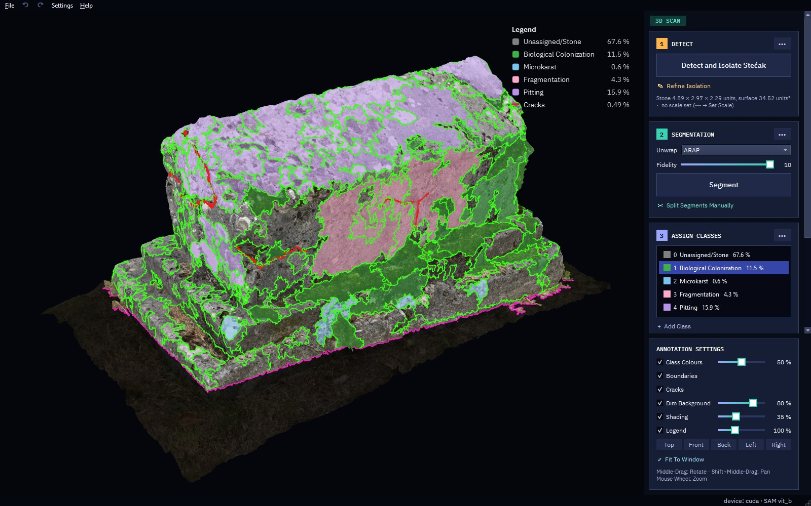
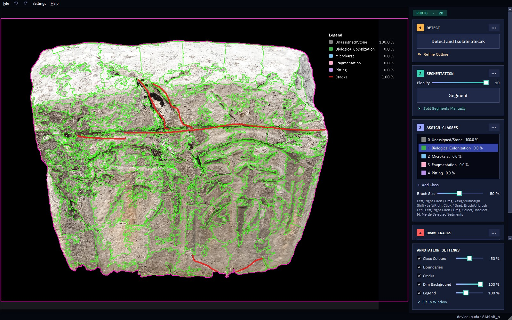
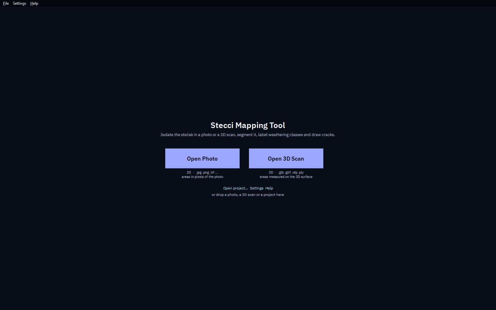

# Stecci Mapping Tool v1

**Version 1.0** · Windows desktop app (Python, PySide6 + OpenGL) for mapping weathering damage on *stećci*,
the medieval tombstones of the Western Balkans.

Open a **photo** or a textured **3D scan** of a stećak. The app isolates the stone from its surroundings,
splits its surface into segments with Meta's [Segment Anything](https://github.com/facebookresearch/segment-anything)
model (SAM), and lets you assign weathering classes (biological colonisation, microkarst, fragmentation, pitting …)
and draw cracks. It then exports maps and measurements: area and percentage per class, and crack length and density.
Everything runs locally and offline.



| Photo workspace | Start page |
|---|---|
|  |  |

## Features

* **Two workspaces, one workflow:** photos (`.jpg .png .tif .bmp .webp`, areas in photo pixels) and 3D scans
  (`.glb .gltf .obj .ply`, textured or with vertex colours; areas measured on the 3D surface, in m² once a scale is set).
* **Four steps:** Detect & isolate the stone → Segment (adjustable fidelity) → Assign classes (click, drag or brush)
  → Draw cracks.
* **Exports:** annotated images, a class map on white, a six-view sheet for scans, the stone as a `.glb` with the
  mapping baked into its texture, and a `.json` with all measurements and the site information.
* **Projects** (`.stecci`, `.stecci3d`) save the full state, with undo / redo.
* **Themes:** Nocturne (default), Classic, Nordic Light and Graphite Pro, switchable live in *Settings → Appearance*.

## Quick start

```powershell
py -3.12 -m venv .venv
.venv\Scripts\pip install torch==2.14.1 torchvision==0.29.1 --index-url https://download.pytorch.org/whl/cu126   # or /whl/cpu
.venv\Scripts\pip install -r requirements.txt
```

The SAM weights are not part of this repository (they are 0.4–2.6 GB). Download at least
[`sam_vit_b_01ec64.pth`](https://dl.fbaipublicfiles.com/segment_anything/sam_vit_b_01ec64.pth) (the default) into a
`models\` folder next to `run.py`. ViT-L ([`sam_vit_l_0b3195.pth`](https://dl.fbaipublicfiles.com/segment_anything/sam_vit_l_0b3195.pth))
and ViT-H ([`sam_vit_h_4b8939.pth`](https://dl.fbaipublicfiles.com/segment_anything/sam_vit_h_4b8939.pth)) are optional.

```powershell
.venv\Scripts\python run.py               # or: run.py photo.jpg / scan.glb / project.stecci3d
```

A CUDA GPU makes segmentation much faster. Without one, the app runs on the CPU.

## Overview

The start page has *Open Photo* and *Open 3D Scan*. **File → Open…** (Ctrl+O), the command line and drag & drop
accept any supported file: photos, scans and both project types (`.stecci`, `.stecci3d`).

One document is open at a time. Opening a file of the other kind closes the current one and asks to save it first.
Both workspaces share one SAM model, which loads once in the background at start-up.

## Workflow (both workspaces)

The right-hand panel has four steps. The `•••` button on each card holds the extra options. A tag at the top of
the panel shows the mode: *PHOTO · 2D* or *3D SCAN*.

| Step | Photo | 3D scan |
|---|---|---|
| **1 Detect** | *Detect and Isolate Stećak*: SAM isolates the stone in the centre of the photo. *Refine Outline* (R): drag a box, left-click = include, right-click = exclude. Menu: fill holes, outline colour / style, *Crop To Box On Export*. | *Detect and Isolate Stećak*: fits the ground plane to the scan's open edge and keeps the largest piece above it, aligned to its box axes. *Refine Isolation* (R): left-drag adds surface, right-drag removes it. Menu: *Ground Cut Height*, *Set Scale* (true stone length → m²), outline colour. |
| **2 Segmentation** | *Fidelity* 0–10 (0 = the whole stone is one segment), then *Segment*: SAM automatic masks, then large segments are split by colour. | Same method, run on a hidden flattened image of the stone. Choose the *Unwrap*: **ARAP** (one piece, no seams; default), **Box net** or **Belt**. Only the segment outlines appear on the model. See [docs/unwrap_comparison.jpg](docs/unwrap_comparison.jpg). |
| | *Split Segments Manually* (X) · Menu: *Clear Segmentation*, keep class assignments when re-segmenting, boundary colour / thickness | |
| **3 Assign Classes** | Pick a class (keys 0–9), click or drag over segments; right-click unassigns. Ctrl+left click / drag selects, Ctrl+right click / drag unselects, **M** merges. **Shift+drag** brushes the active class, Shift+right-drag brushes *Unassigned/Stone*, Shift+wheel sets the brush size. *+ Add Class*; right-click a class to rename / recolour / delete it. | |
| **4 Draw Cracks** (B) | Left-drag paints, right-drag erases (5× brush). `[` `]` or Ctrl+wheel = brush size. | |

**Annotation Settings** (bottom right): Class Colours (opacity), Boundaries, Cracks, Dim Background (strength) and
Legend (size). The 3D workspace adds Shading and the standard views (Top / Front / Back / Left / Right).
In the photo workspace you can drag the legend, resize it with the mouse wheel, and double-click it to reset it.

**Navigation**
* Photo: wheel = zoom · middle-drag or Space+drag = pan · F = fit
* 3D: middle-drag, Alt+drag or drag beside the stone = rotate · Shift+middle-drag = pan · wheel = zoom ·
  double-click = rotate around that point · F = fit

## Export (Ctrl+E)

The dialog asks for the stećak name, site information (site, side, survey date, surveyor, notes) and folder.
The site information is saved with the project, and the surveyor is remembered.

| Photo | 3D scan |
|---|---|
| `<name>.png`: as on the screen | `<name>.png`: the current view, with the legend |
| `<name>_white.png`: class map on white | `<name>_views.png`: six views with classes, boundaries, cracks and legend |
| `<name>_surroundings.png`, `<name>_cracks.png`, `<name>_stone.png`, `<name>_stone_outlines.png` | `<name>.glb`: the isolated stone with the mapping burned into its texture |
| `<name>.json`: areas, % per class, patches, crack length / width / density (photo pixels) | `<name>.json`: stone size and area, per-class area and %, cracks (model units, or m² once the scale is set) |

## Self-test

`python run.py --selftest` loads SAM, runs isolation and segmentation on a synthetic photo, checks the 3D modules,
and writes `selftest.log`.

## Models and settings

* SAM checkpoints (`sam_vit_b_01ec64.pth` is the default, ViT-L / ViT-H are optional) are loaded only from `./models`
  (next to `run.py`, or next to the `.exe` in a build), or from a path set in Settings. The app runs offline.
* **Settings** (Ctrl+,) has four groups:
  * **Appearance**: theme (previewed live; Cancel restores the previous one).
  * **Models** (both workspaces): SAM model, checkpoint, segment detail (*Colour*, the default, or *SAM shapes*),
    SAM points.
  * **Photos**: working max side (default 2048 px).
  * **3D scans**: default unwrap, unwrap resolution (3072 px), max triangles on import (500,000; 0 = full),
    texture of reduced scans, display texture size, ground cut height.
* Display preferences (colours, line styles, dimming, shading) are remembered separately for each workspace.
* Converted scans are cached in `%LOCALAPPDATA%\Stecci3D\cache`, the same folder the earlier 3D prototype uses, so scans it
  already converted open quickly. A 3D project references its scan by path and always reopens with the triangle
  limit it was made with.

## Building the exe

One-folder PyInstaller builds with SAM ViT-B in `models/`, runnable offline (zip the folder to hand it on). The spec also
collects PyOpenGL and trimesh for the 3D workspace. This build has not been tested yet.

```powershell
.venv\Scripts\pip install pyinstaller
.venv\Scripts\python packaging\build.py            # gpu + cpu; or: build.py gpu / cpu  (cpu needs .venv-cpu)
```

## Code layout

```
stecci/
  config.py          settings (models, photos, 3D), fidelity levels, classes, file types, model paths
  models.py          SAM (+ optional Grounding DINO) wrapper, shared by both workspaces
  segmentation.py    2D label-map logic: masks → partition, merge, split, colour subdivision
  image2d/           photo backend: project (state, undo, save / load, export), rendering, measurements
  scan3d/            3D backend: mesh import + cache, reduction, isolation, unwrap, surface segments,
                     rasteriser, project, export (views sheet, GLB)
  ui/
    main_window.py   start page, menus, status bar, open / switch / close, settings, model preload, job runner
    workspace.py     base of both workspaces: panel building blocks, class list, assign / select, undo plumbing
    workspace2d.py   photo workspace (canvas + panel)
    workspace3d.py   3D workspace (OpenGL viewer + panel)
    theme.py         the four themes: palette, fonts and the app-wide style sheet
    canvas.py, viewer.py, legend.py, busy_overlay.py, worker.py, export_dialog.py, settings_dialog.py, widgets.py
  assets/fonts/      IBM Plex Sans / Mono (SIL Open Font License) used by the themes
```

Shortcuts belong to each workspace and only work while that workspace is on screen, so both can use the same keys.

## Background

This app combines two earlier prototypes, a 2D photo tool and a 3D scan tool, in one application. Projects made with them open unchanged. Changes compared with them:


* One app and one settings dialog for both kinds of data. One SAM instance serves both.
* The photo workspace gets *Clear Segmentation* from the 3D tool.
* The 3D workspace gets the crack-colour swatch and the *Stop Drawing Cracks* toggle text from the photo tool.
* Undo / redo arrows are greyed out when there is nothing to undo or redo, in both workspaces.
* *File → Close* (Ctrl+W) closes the document and returns to the start page.
* A failed project load leaves the current document untouched.
